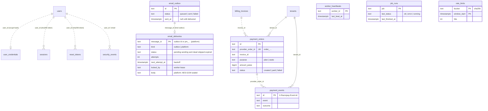

# SeereonOS ERD (core entities)

This diagram covers the core entities only. The full column list is the data dictionary in `README.md`.

Every table except `tenants` carries `tenant_id`, and every FK is composite, `(tenant_id, x) → parent (tenant_id, id)`,
so a reference can never cross tenants. The tenant edges are drawn only for a few tables. Dashed lines are references
that deliberately have no FK; `server/db/tools/relations.ts` `OMITTED` (Node phase, git history) explains each one.

```mermaid
erDiagram
  tenants ||--o{ users : "tenant_id"
  tenants ||--o{ projects : "tenant_id"
  tenants ||--o{ roles : "tenant_id"
  tenants ||--o{ number_sequences : "tenant_id"

  roles ||..o{ users : "role_key (by key)"
  users ||--o{ users : "reports_to_id"
  departments ||--o{ users : "department_id"
  designations ||--o{ users : "designation_id"
  grades ||--o{ users : "grade_id"
  locations ||--o{ users : "location_id"
  shifts ||--o{ users : "shift_id"
  cost_centres ||--o{ users : "cost_centre_id"
  departments ||--o{ designations : "department_id"
  users ||--o{ cost_rates : "user_id"

  clients ||--o{ contracts : "client_id"
  clients ||--o{ invoices : "client_id"
  deals ||--o{ deal_activities : "deal_id (cascade)"
  deals ||--o{ deal_stage_history : "deal_id (cascade)"
  deals |o--o{ projects : "deal_id (set null)"
  users ||--o{ deals : "owner_id"

  users |o--o{ projects : "pm_id"
  projects ||--o{ milestones : "project_id"
  projects ||--o{ tasks : "project_id"
  milestones |o--o{ tasks : "milestone_id"
  users |o--o{ tasks : "owner_id"
  tasks ||--o{ task_dependencies : "task_id (cascade)"
  tasks ||--o{ comments : "task_id (cascade)"
  tasks ||..o{ task_reviews : "task_id (no FK)"
  projects ||--o{ allocations : "project_id"
  users ||--o{ allocations : "user_id"
  projects ||--o{ change_requests : "project_id"

  users ||--o{ timesheet_weeks : "user_id"
  timesheet_weeks ||--o{ timesheet_entries : "week_id"
  tasks ||..o{ timesheet_entries : "task_id (no FK)"
  users ||--o{ leave_requests : "user_id"
  users ||--o{ leave : "user_id"

  projects ||--o{ invoices : "project_id"
  invoices ||--o{ payments : "invoice_id"
  projects |o--o{ ledger_entries : "project_id"
  payroll_runs ||--o{ payroll_lines : "run_id"
  users ||--o{ expense_claims : "user_id"
  vendors ||--o{ purchase_orders : "vendor_id"
  vendors ||--o{ vendor_bills : "vendor_id"
  purchase_orders |o--o{ vendor_bills : "po_id"

  documents ||--o{ document_versions : "document_id"
  documents ||--o{ document_acks : "document_id"
  doc_templates |o--o{ issued_documents : "template_id"
  users ||--o{ issued_documents : "employee_id"
  users ||--o{ employee_documents : "employee_id"

  appraisal_cycles ||--o{ appraisals : "cycle_id"
  users ||--o{ appraisals : "user_id"
  objectives ||--o{ key_results : "objective_id (cascade)"
  objectives |o--o{ objectives : "parent_id"
  wf_templates ||--o{ wf_instances : "template_id"

  users ||--o| user_credentials : "user_id"
  users ||--o{ sessions : "user_id"

  tenants {
    text id PK
    text slug UK
    text status
    jsonb settings
    jsonb theme
  }
  users {
    text id PK
    text tenant_id
    text email UK "lower(email), global"
    text role_key
    text employee_code UK "per tenant"
  }
  projects {
    text id PK
    text tenant_id
    text code UK "per tenant"
    text pm_id FK
    text deal_id FK
    bigint contract_value_paise
  }
  tasks {
    text id PK
    text project_id FK
    text milestone_id FK
    text owner_id FK
    text status
    jsonb wf_chain
  }
  timesheet_entries {
    text id PK
    text week_id FK
    text user_id FK
    date work_date
    double hours
  }
  invoices {
    text id PK
    text project_id FK
    text number UK "per tenant, issued"
    bigint amount_paise
    jsonb lines
  }
  sessions {
    text token_hash PK
    text user_id FK
    text tenant_id
    timestamptz expires_at
  }
```

## Platform, delivery, payments and jobs (V001, V006, V008)

The runtime role `seereon_app` reaches the credential, session, token, rate-limit, audit and delivery tables only
through the `SECURITY DEFINER` functions of V008 (README "Roles and the security boundary"); `payment_orders` and
`payment_events` are ordinary tenant tables (RLS, version triggers). Dashed lines are references without an FK (the
platform tables predate per-tenant composite keys and must survive tenant deletion for audit).

`worker_heartbeats`, `job_runs` and `rate_limits` stand alone. v8 also made `allocations.milestone_id` and the costing
resource rows' milestone optional in the domain logic: NULL means "All milestones" (no schema change: the column was
already nullable).
